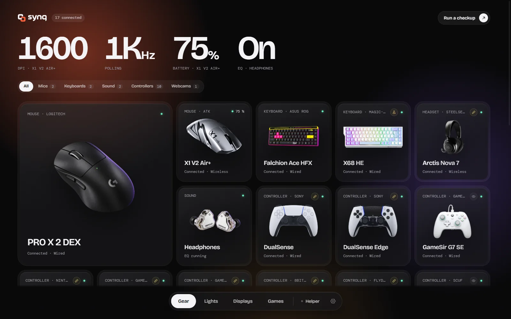
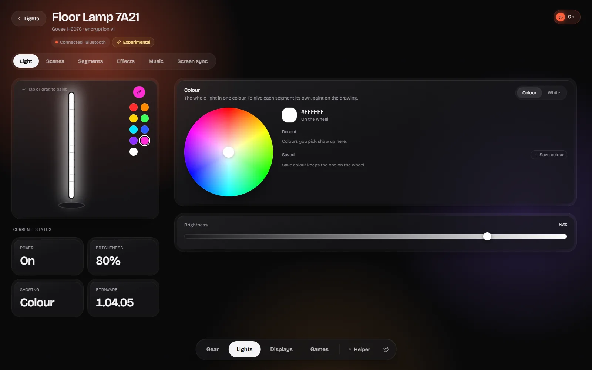
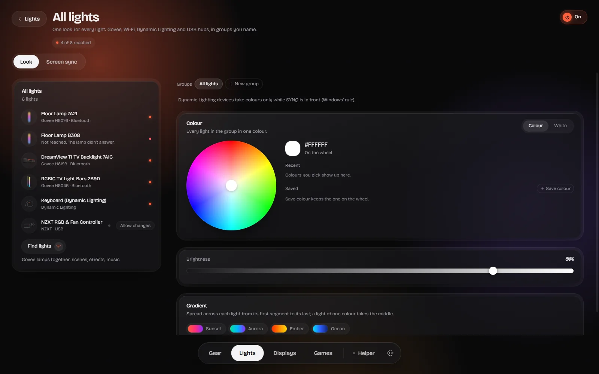

# SYNQ

[](https://github.com/logan-wurx/synqhub/actions/workflows/linux.yml)
[](LICENSE)

One light app for all your gear: mice, keyboards, controllers, headphones and headsets, monitors, webcams and RGB
lights, without each maker's app. Settings are written to the devices themselves, so nothing has to run in the
background. Free software under the [GNU AGPL 3.0 or later](LICENSE).



- **Devices.** Mice (DPI, polling up to 8K, lift-off and more), keyboards (per-key actuation and rapid trigger on
  magnetic boards), controllers (a live tester: drift, circularity, deadzones, the real polling rate; settings for some
  pads), headsets (battery, sidetone, their own settings) and webcams (exposure, focus, white balance).
- **Sound.** A system-wide EQ on Equalizer APO, presets for about 6,000 headphones from AutoEq, auto preamp, and a backup
  of every change. It never saves an EQ louder than the source.
- **Lights.** Govee lights over Bluetooth with no Govee app, Philips Hue, Nanoleaf, Elgato, Twinkly, WiZ, Yeelight and
  LIFX on your home network, Windows Dynamic Lighting devices and USB RGB hubs, in one Lights view with screen sync.
- **Displays.** Brightness, contrast, colour and input over DDC/CI.
- **Gear Doctor** checks your gear in about a minute; **Pro setups** translate a pro player's settings to your mouse.

**Careful by default.** Every outgoing report passes an allowlist that the Rust bridge checks again. Every change is
backed up first and read back after. Firmware and bootloader commands are never sent; pairing and factory reset, where a
page offers them, wait for a confirmation and a backup. A device SYNQ hasn't been tried on stays read-only until you
turn on **Allow changes**. What each device gets, and how far it
has been tested, is in [docs/devices/CAPABILITIES.md](docs/devices/CAPABILITIES.md).

**Nothing in the background.** SYNQ runs while its window is open. The optional SYNQ Helper (off unless you turn it
on) adds per-game profiles, battery alerts and a bridge for the website; see [docs/helper.md](docs/helper.md). It goes
online only when you use something that needs it: a VIA keyboard's layout, the AutoEq headphone list, Steam cover art.

| Lights | Sound | All lights together |
|---|---|---|
|  |  |  |

## Download

Get the newest installer from [Releases](https://github.com/logan-wurx/synqhub/releases): Windows 10 or 11 (64-bit),
or the `.deb` / AppImage for Linux. SYNQ is in beta and the installer isn't code-signed yet, so Windows SmartScreen
asks once: **More info**, then **Run anyway**.

**Tested by hand:** Logitech PRO X 2 DEX, ATK X1 V2 Air+, ROG Falchion Ace HFX (and, so far, the connection and power of
Govee's H6076 floor lamp). Everything else is built from documented protocols and simulations, and says **Experimental**
until someone with that device has tried it. If that's you, a
[diagnostics file](CONTRIBUTING.md#reporting-a-device-that-misbehaves) helps a lot.

## Run from source

The short version is below; [CONTRIBUTING.md](CONTRIBUTING.md) has the full setup and the rules for device code.

```bash
npm install
npm run tauri dev
```

`npm run dev` opens the UI in a browser with sample data and saves nothing.

Every check (TypeScript, node tests, simulations, the app's and the helper's Rust tests, both builds), the same
locally and in CI:

```bash
npm run verify
```

## Linux

The Linux app (.deb and AppImage, built and tested in CI on Ubuntu 22.04) runs the EQ in PipeWire, reaches devices
through hidraw with a udev rule generated from the bridge's own tables, and runs SYNQ Helper from XDG autostart.
See [docs/linux.md](docs/linux.md), including what is still untested on real hardware.

Before `npm run tauri build` (or `dev`) on a fresh clone, fetch the bundled EQ engine installer once. It is checked
against its SHA-256 and kept out of git:

```bash
node src-tauri/eq-engine/fetch.mjs
```

## Brand

The logo pack is in [`branding/synq/source`](branding/synq/source) and its vector tracing in [`branding/synq/svg`](branding/synq/svg). `python branding/synq/build.py` makes every other brand file from it (installer art, website icons, link preview, README banner, the app's logo paths), then `npx tauri icon branding/synq/app-icon-1024.png -o src-tauri/icons` makes the app icons.

## License

SYNQ is free software: you can redistribute it and/or modify it under the terms of the GNU Affero General Public
License as published by the Free Software Foundation, either version 3 of the License, or (at your option) any later
version. It is distributed in the hope that it will be useful, but WITHOUT ANY WARRANTY; see [LICENSE](LICENSE).
Copyright (C) 2026 logan-wurx.

Not covered by that license:

- **Product images © their respective owners. Want one removed? Open an issue.** The device pictures in
  `src/assets/devices` are the makers' own product photos and configurator images, shown to identify each device.
  Where each one came from is in [`src/assets/devices/SOURCES.json`](src/assets/devices/SOURCES.json). Devices
  without a picture get a drawing of their own shape.
- **The SYNQ name and logo** (`branding/`) identify this project; forks should use their own.
- **Equalizer APO** by Jonas Thedering, GPL-2.0 ([license text](src/assets/licenses/equalizer-apo-GPL-2.0.txt), source:
  <https://sourceforge.net/projects/equalizerapo/>). The Windows installer bundles the unmodified official
  `EqualizerAPO-x64-1.4.2.exe` and runs it as a separate program. The credit is also in the app (Sound › EQ engine).

Built on: OpenMouse's protocol and keyboard drivers (AGPL-3.0-or-later), AnalogSense (MIT), HeadsetControl's headset
protocols (GPL-3.0), AutoEq (MIT), and the protocol notes of ha-govee-led-ble (MIT), govee_ble_lights (MIT) and OpenRGB
(GPL-2.0, facts only). The full list is in the app (Settings › Licenses) and in each area's docs. The Uiverse elements
are MIT (credits in `src/components/uiverse/uiverse.css`); the 21st.dev components are credited in their files.
