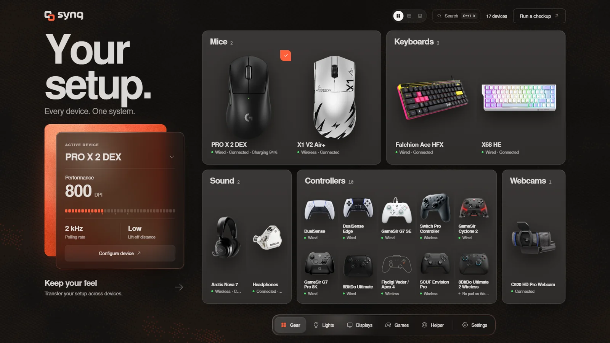
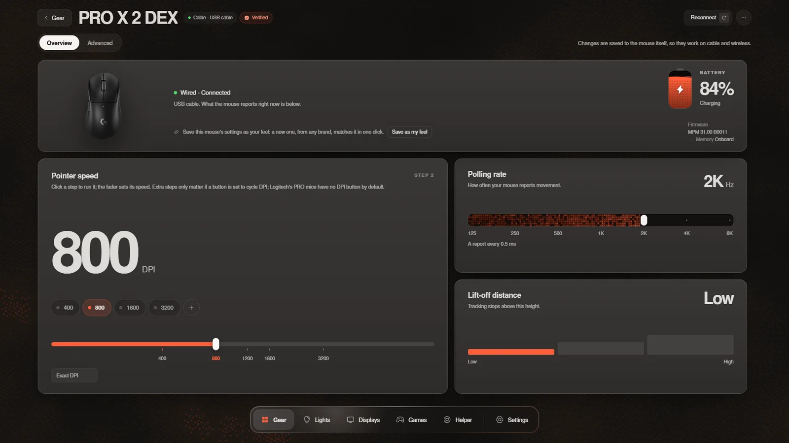
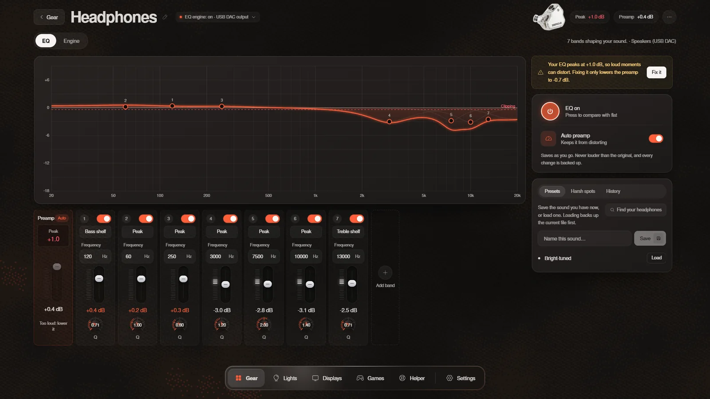
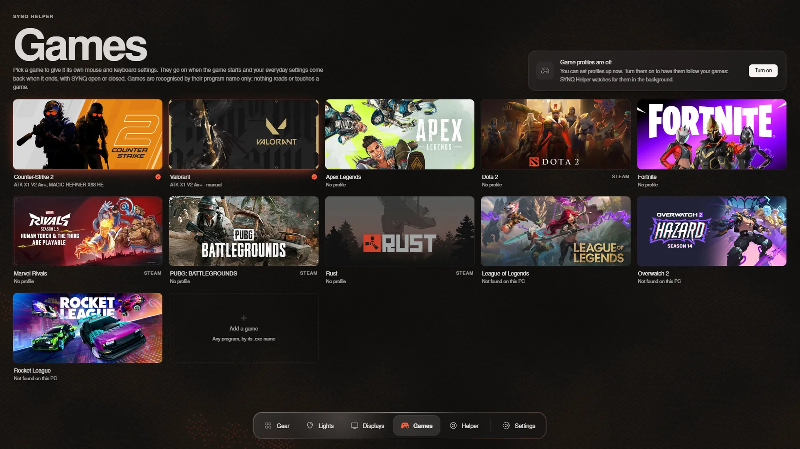
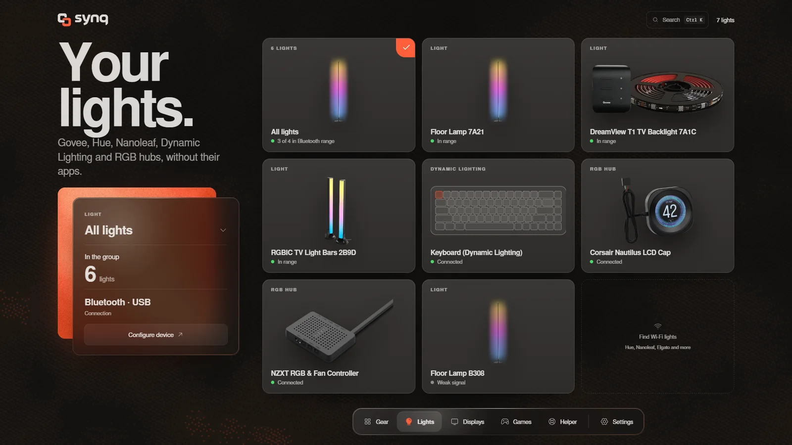

<p align="center">
  
</p>

<h1 align="center">SYNQ</h1>

<p align="center">
  <b>One free app for your mouse, keyboard, controller, headphones, monitor, webcam and lights.</b><br>
  Windows and Linux, or right in your browser. No account, no telemetry, no sponsors.
</p>

<p align="center">
  <a href="https://github.com/logan-wurx/synqhub/releases/latest"></a>
  <a href="https://synqhub.app"></a>
  <a href="https://discord.gg/WP9HFebp8D"></a>
  <a href="https://github.com/logan-wurx/synqhub/actions/workflows/linux.yml"></a>
  <a href="LICENSE"></a>
</p>

<p align="center">
  <a href="#download">Download</a> ·
  <a href="https://synqhub.app">Use it in your browser</a> ·
  <a href="#what-it-does">What it does</a> ·
  <a href="#tested-hardware">Tested hardware</a> ·
  <a href="https://discord.gg/WP9HFebp8D">Discord</a>
</p>

<p align="center">
  
</p>

SYNQ replaces each maker's app with one light one. Settings are written to the devices themselves, so you can close it
and they stay. It is free software under the [GNU AGPL 3.0 or later](LICENSE).

## Download

| Platform | Get it | Notes |
|---|---|---|
| **Windows 10 / 11** | [Installer (.exe)](https://github.com/logan-wurx/synqhub/releases/latest) | 64-bit. Not code-signed yet: when Windows says "Windows protected your PC", click **More info**, then **Run anyway**. |
| **Linux** | [.deb or AppImage](https://github.com/logan-wurx/synqhub/releases/latest) | x86-64. The .deb for Ubuntu 22.04+ and Debian 12+, the AppImage for other distributions. [Linux guide](docs/linux.md) |
| **Browser** | [synqhub.app](https://synqhub.app) | Chrome, Edge or Opera on a computer, nothing to install for mice and keyboards. [SYNQ Helper](https://github.com/logan-wurx/synqhub/releases/latest/download/synq-helper.exe) (Windows, installs without administrator) adds the EQ, monitors, webcams, Wi-Fi lights and game profiles. |

Every file's SHA-256 is in `SHA256SUMS.txt` on the [release page](https://github.com/logan-wurx/synqhub/releases/latest).

**Linux in one line** (the .deb also installs SYNQ Helper and the device rule):

```bash
sudo apt install ./SYNQ_*_amd64.deb
```

## What it does

| Area | What you get |
|---|---|
| **Mice** | DPI steps, polling up to 8K, lift-off distance, and debounce, motion sync and angle snapping where the mouse has them. |
| **Keyboards** | Per-key actuation, rapid trigger and SOCD on magnetic boards, plus lighting and polling rate. |
| **Game profiles** | A game's settings go on when it starts and your everyday ones come back when it closes, with SYNQ open or closed. Every mouse and keyboard SYNQ drives. |
| **Sound** | A system-wide EQ (Equalizer APO on Windows, PipeWire on Linux), about 6,000 headphone presets from AutoEq, auto preamp, Harsh spots, and a backup of every change. It never saves an EQ louder than the source. |
| **Controllers** | A live tester: drift, circularity, deadzones, triggers, gyro and the real polling rate. Experimental settings for DualSense Edge, GameSir, 8BitDo and Flydigi pads. |
| **Headsets** | Battery, chat-mix and their own settings for 27 gaming headsets. |
| **Lights** | Govee over Bluetooth with no Govee app, Philips Hue, Nanoleaf, Elgato, Twinkly, WiZ, Yeelight, LIFX, Windows Dynamic Lighting and USB RGB hubs, in one view with screen sync. |
| **Displays and webcams** | Brightness, contrast, colour and input over DDC/CI. Exposure, focus, zoom and white balance over UVC. |
| **Keep your feel** | Save how your mouse and keyboard feel and carry it to a new one of any brand. 41 CS2 and Valorant pros' setups, translated to your mouse. |
| **Gear Doctor** | A one-minute checkup with a report card per device, and **Fix it** with **Undo**. |

<table>
  <tr>
    <td width="50%"></td>
    <td width="50%"></td>
  </tr>
  <tr>
    <td align="center">One page per device</td>
    <td align="center">A system-wide EQ</td>
  </tr>
  <tr>
    <td width="50%"></td>
    <td width="50%"></td>
  </tr>
  <tr>
    <td align="center">Game profiles</td>
    <td align="center">All your lights together</td>
  </tr>
</table>

## Careful by default

- Every outgoing report passes an allowlist that the Rust bridge checks again.
- Every change is backed up first and read back after.
- Firmware and bootloader commands are never sent. Pairing and factory reset, where a page offers them, wait for a
  confirmation and a backup.
- A device SYNQ hasn't been tried on stays read-only until you turn on **Allow changes**.

What each device gets, and how far it has been tested: [docs/devices/CAPABILITIES.md](docs/devices/CAPABILITIES.md).

## Privacy

- No account, no telemetry, no sponsors, nothing bundled.
- Close SYNQ and nothing runs, unless you turn on SYNQ Helper for game profiles and battery alerts
  ([docs/helper.md](docs/helper.md)).
- SYNQ goes online only for what needs it: a VIA keyboard's layout, the AutoEq headphone list, Steam cover art, and the
  official Equalizer APO installer when SYNQ Helper sets up the EQ without one.
- The website counts visits anonymously through Cloudflare Web Analytics (no cookies). The desktop app has no analytics.

## Tested hardware

| Device | Status |
|---|---|
| Logitech PRO X 2 DEX | Tested by hand, cable and receiver |
| ATK X1 V2 Air+ | Tested by hand, cable and receiver |
| ROG Falchion Ace HFX | Tested by hand |
| Govee H6076 floor lamp | Connection and power tested |
| Everything else | Built from documented protocols and simulations. Marked **Experimental** until an owner has tried it. |

Own something on the experimental list? A [diagnostics file](CONTRIBUTING.md#reporting-a-device-that-misbehaves)
helps a lot.

## Built on open source

SYNQ stands on other people's open work. Much of its mouse support runs on
[OpenMouse](https://github.com/OpenMouse-Project/openmouse)'s driver library (`@openmouse/protocol`), its keyboard
drivers (`@openmouse/keyboard-protocol`) are behind more of the keyboards, and some of the device photos come from
[openmouse.app](https://openmouse.app). Thank you to the OpenMouse project and everyone who writes its drivers.

| Project | What SYNQ uses it for | License |
|---|---|---|
| [OpenMouse](https://github.com/OpenMouse-Project/openmouse) | Mouse and keyboard drivers, some device photos | AGPL-3.0-or-later |
| [Equalizer APO](https://sourceforge.net/projects/equalizerapo/) | The EQ engine on Windows | GPL-2.0 |
| [AutoEq](https://github.com/jaakkopasanen/AutoEq) | Headphone presets | MIT |
| [HeadsetControl](https://github.com/Sapd/HeadsetControl) | Headset protocols | GPL-3.0 |
| AnalogSense | Live key depth | MIT |
| ha-govee-led-ble, govee_ble_lights | Govee protocol notes and scenes | MIT |
| [OpenRGB](https://openrgb.org) | USB RGB hub protocol notes (facts only) | GPL-2.0 |

The full list is in the app (Settings › Licenses).

## Community

- **[Discord](https://discord.gg/WP9HFebp8D):** bugs, device requests and release news.
- **[Issues](https://github.com/logan-wurx/synqhub/issues/new/choose):** bug reports and "support my device" requests.
- **Security:** something that could damage a device or a PC goes through [SECURITY.md](SECURITY.md), not a public issue.

## Run from source

<details>
<summary>Build and test SYNQ yourself</summary>

<br>

[CONTRIBUTING.md](CONTRIBUTING.md) has the full setup and the rules for device code.

```bash
npm install
npm run tauri dev
```

`npm run dev` opens the UI in a browser with sample data and saves nothing.

Every check (TypeScript, node tests, simulations, the app's and the helper's Rust tests, both builds), the same
locally and in CI:

```bash
npm run verify
```

Before `npm run tauri build` (or `dev`) on a fresh clone, fetch the bundled EQ engine installer once. It is checked
against its SHA-256 and kept out of git:

```bash
node src-tauri/eq-engine/fetch.mjs
```

On Linux the app runs the EQ in PipeWire, reaches devices through hidraw with a udev rule generated from the bridge's
own tables, and starts SYNQ Helper from XDG autostart. [docs/linux.md](docs/linux.md) has the details, including what
is still untested on real hardware.

**Brand files.** The logo pack is in [`branding/synq/source`](branding/synq/source) and its vector tracing in
[`branding/synq/svg`](branding/synq/svg). `python branding/synq/build.py` makes every other brand file from it
(installer art, website icons, link preview, README banner, the app's logo paths), then
`npx tauri icon branding/synq/app-icon-1024.png -o src-tauri/icons` makes the app icons.

</details>

## License

SYNQ is free software: you can redistribute it and/or modify it under the terms of the GNU Affero General Public
License as published by the Free Software Foundation, either version 3 of the License, or (at your option) any later
version. It is distributed in the hope that it will be useful, but WITHOUT ANY WARRANTY; see [LICENSE](LICENSE).
Copyright (C) 2026 logan-wurx.

<details>
<summary>What the license doesn't cover</summary>

<br>

Not covered by that license:

- **Product images © their respective owners. Want one removed? Open an issue.** The device pictures in
  `src/assets/devices` are the makers' own product photos and configurator images, shown to identify each device.
  Where each one came from is in [`src/assets/devices/SOURCES.json`](src/assets/devices/SOURCES.json). Devices
  without a picture get a drawing of their own shape.
- **The SYNQ name and logo** (`branding/`) identify this project; forks should use their own.
- **Equalizer APO** by Jonas Thedering, GPL-2.0 ([license text](src/assets/licenses/equalizer-apo-GPL-2.0.txt), source:
  <https://sourceforge.net/projects/equalizerapo/>). The Windows installer bundles the unmodified official
  `EqualizerAPO-x64-1.4.2.exe` and runs it as a separate program. The credit is also in the app (Sound › EQ engine).

The Uiverse elements are MIT (credits in `src/components/uiverse/uiverse.css`); the 21st.dev components are credited
in their files. Each area's docs name its sources.

</details>
